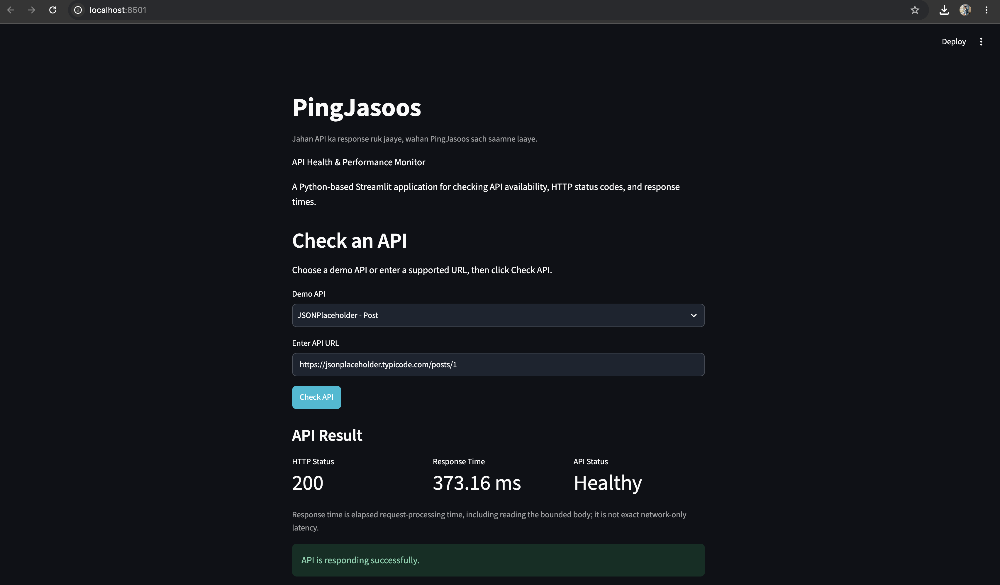
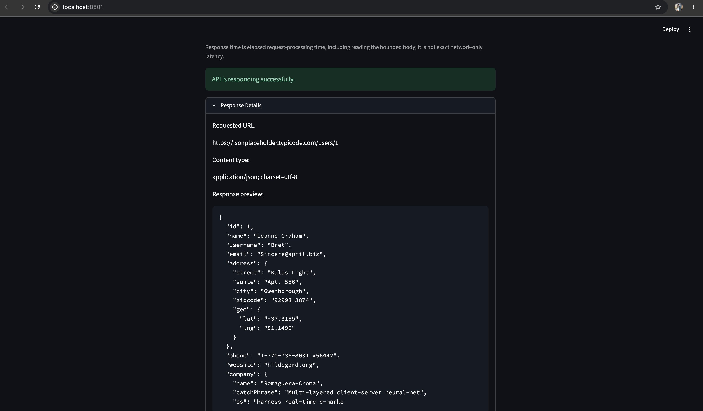
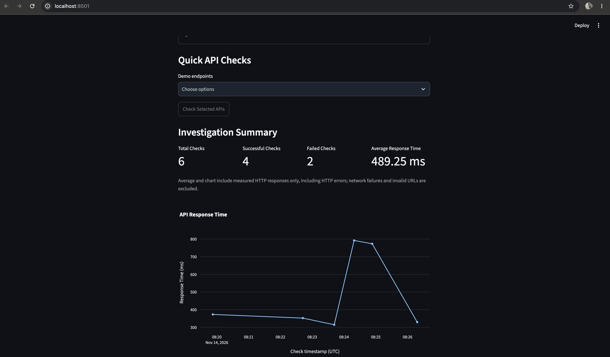
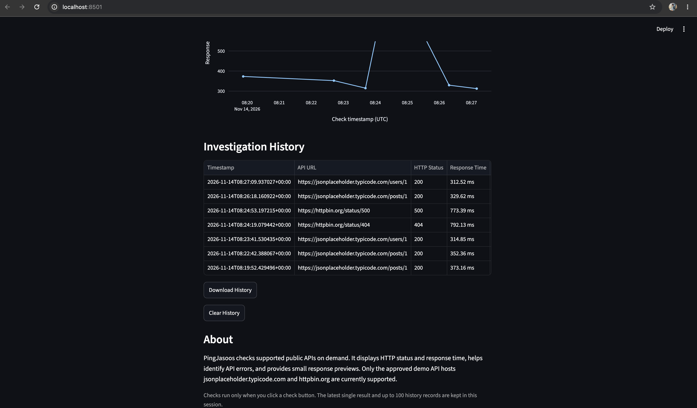

# PingJasoos

Jahan API ka response ruk jaaye,\
wahan PingJasoos sach saamne laaye.

## Overview

PingJasoos — API Health & Performance Monitor is a Python-based Streamlit application for checking supported public API endpoints on demand. It displays HTTP status codes, elapsed response times, and response previews, and helps identify HTTP and network errors. Session history, investigation statistics, a response-time chart, and CSV export make it easier to review checks without a database or continuous monitoring service.

## Features

- Check a demo endpoint or enter a URL on an approved host.
- View HTTP status, response time, and a preview of up to 500 characters.
- Handle invalid URLs, HTTP errors, redirects, timeouts, connection failures, and invalid JSON.
- Run up to five approved demo checks sequentially.
- Review UTC-timestamped history, successful/failed counts, and average HTTP response time.
- Plot measured HTTP response times in chronological order.
- Download newest-first history as CSV with spreadsheet formula protection.
- Clear history while keeping the latest single API result.

Only HTTP 2xx counts as successful. Averages and charts exclude checks without an HTTP response or usable latency. History stores metadata rather than response bodies or previews; stored URLs omit credentials, query strings, and fragments. Latest-result details still display the requested URL.

## Tech Stack

Python, Streamlit, Requests, Pandas, Plotly, and Pytest.

## Screenshots

### API Health Checker



### Response Inspector



### Performance Analytics



### Investigation History



## Project Structure

```text
PingJasoos/
├── app.py
├── utils/
│   ├── __init__.py
│   ├── api_checker.py
│   └── data_handler.py
├── tests/
│   ├── __init__.py
│   ├── test_api_checker.py
│   ├── test_app.py
│   └── test_data_handler.py
├── assets/
├── .streamlit/
│   └── config.toml
├── .gitignore
├── requirements.txt
├── LICENSE
└── README.md
```

## Installation

Use Python 3.12 on macOS. Once the repository is published at the intended URL:

```bash
git clone https://github.com/rrayyann7811/PingJasoos.git
cd PingJasoos
python3.12 -m venv .venv
source .venv/bin/activate
python -m pip install -r requirements.txt
python -m streamlit run app.py
```

For an existing local copy, start with `python3.12 -m venv .venv` in the project directory. Open the local URL printed by Streamlit. Press `Ctrl+C` to stop.

## Usage

1. Select a demo API or enter a supported URL, such as `https://jsonplaceholder.typicode.com/posts/1`.
2. Click **Check API**.
3. Review the HTTP status, response time, and API status.
4. Expand **Response Details** to inspect the preview and any error message.
5. Perform additional checks, or select demo endpoints under **Quick API Checks** and click **Check Selected APIs**.
6. Review **Investigation Summary**, the response-time chart, and **Investigation History**.
7. Click **Download History** to save `pingjasoos_history.csv`. Use **Clear History** to reset historical records and analytics.

Changing a widget does not send an API request.

## Testing

With the virtual environment active:

```bash
python -m pytest -q
python -m compileall -q app.py utils tests
python -m pip check
```

Tests use mocked network requests and Streamlit AppTest; public API availability is not required.

## Limitations

- Only `jsonplaceholder.typicode.com` and `httpbin.org` are supported, using HTTP/HTTPS on standard ports. Redirects are not followed.
- Checks run on demand; continuous monitoring is not provided.
- History lives in the active session, is limited to 100 records, and is lost when the session ends.
- Body reading retains at most 1 MiB of decompressed response bytes; larger responses produce a partial-preview warning. Previews are limited to 500 characters.
- Response time is elapsed request-processing time, including bounded body reading and preview preparation, not network-only latency.
- The five-second connection/read inactivity timeout is not a strict total-operation deadline.
- Public demo API availability and response times can vary.

## Future Improvements

Optional future work could include additional approved endpoints, persistent history, and scheduled checks. These are not implemented.

## Author

Syed Rayyan Ali\
GitHub: [rrayyann7811](https://github.com/rrayyann7811)

Licensed under the [MIT License](LICENSE).
